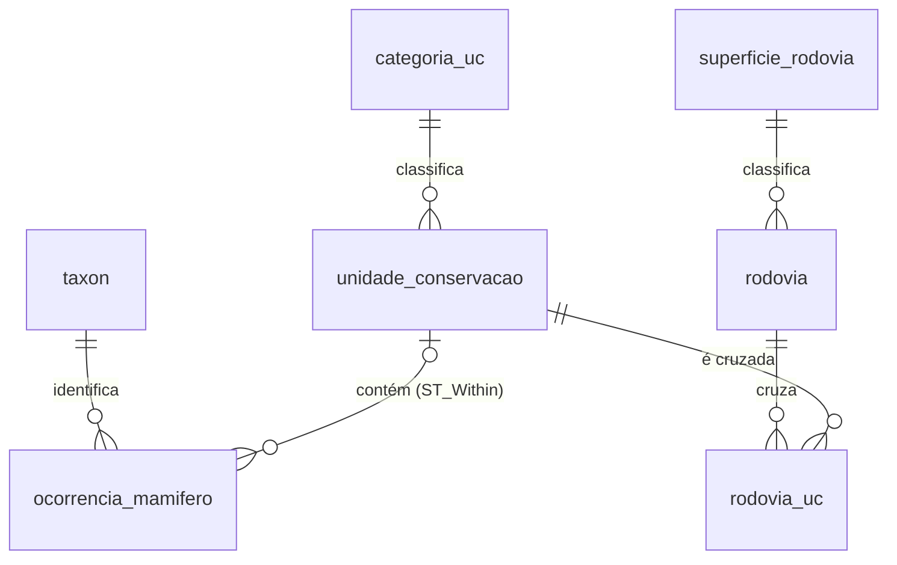

# Mamíferos, Unidades de Conservação e Rodovias em Minas Gerais (PostGIS)

Trabalho de **CSI803 – Banco de Dados Geográficos** (UFOP, Prof. Bruno R. Monteiro) — *Coleta e Documentação de uma Base de Dados Geográficos*.
Autores:
- Lucas Salgado Vieira (22.2.8083)
- Edson Paschoal Neto (22.1.8003)
- Gustavo Guimarães de Oliveira Dias (22.2.8020)
- Gabriel Soares Avelino (22.1.8114)

Base PostGIS com **3 tabelas espaciais** (+ 1 associativa e 3 de domínio):

| Tabela | Geometria | Registros |
|---|---|---|
| `unidade_conservacao` | MultiPolygon, 4674 | 190 |
| `rodovia` | MultiLineString, 4674 | 3.234 |
| `ocorrencia_mamifero` | Point, 4674 | 13.312 |
| `rodovia_uc` | (associativa) | 232 |
| `categoria_uc`, `superficie_rodovia`, `taxon` | (domínio) | 9 / 7 / 414 |

Documentação completa em [`DICIONARIO.md`](DICIONARIO.md). Diagrama: [`docs/der.png`](docs/der.png).



## Fontes e licenças

| Dado | Fonte | Coleta | Licença |
|---|---|---|---|
| UCs estaduais e federais | IDE-Sisema (SEMAD-MG): https://idesisema.meioambiente.mg.gov.br, camadas `ide_2010_mg_unidades_conservacao_estaduais_pol` e `..._federais_pol` | 23/11/2026 | **A confirmar** nos metadados da camada |
| Rodovias | IDE-Sisema, camada `ide_0401_mg_rodovias_lin` (ref. CIDE 2021) | 23/11/2026 | **A confirmar** nos metadados da camada |
| Ocorrências de mamíferos | GBIF.org, download `0012809-261118162104854` | 18/11/2026 | CC0 1.0 / CC BY 4.0 (por registro) |

**Como citar a base:** *Vieira, L. S. (2026). Mamíferos, Unidades de Conservação e Rodovias em Minas Gerais (PostGIS). Trabalho de CSI803, UFOP.* Dados: IDE-Sisema/SEMAD-MG; GBIF.org (18 Nov 2026) GBIF Occurrence Download https://www.gbif.org/occurrence/download/0012809-261118162104854 (**DOI a preencher** a partir da página do download).

## Requisitos

- PostgreSQL 16+ e PostGIS 3.4+. Importação testada em banco limpo em duas instalações:
  - PostgreSQL 16.15 + PostGIS 3.4.2 (GEOS 3.12.1, PROJ 9.4.0), Linux;
  - PostgreSQL 19.0 + PostGIS 3.7.0 (GEOS 3.15.0, PROJ 9.8.1), Windows 11.
  
  Deve funcionar a partir do PostGIS 3.1 (colunas geradas exigem PostgreSQL ≥ 12).
- Para refazer o tratamento (opcional): Python 3.10+ e `pip install -r scripts/requirements.txt`.

## Importação (banco limpo)

Execute **da raiz do repositório** (os caminhos do `\copy` são relativos):

```bash
createdb mamiferos_uc_rodovias_mg
psql -d mamiferos_uc_rodovias_mg -v ON_ERROR_STOP=1 -f sql/schema.sql     # extensão, tabelas, restrições, índices GiST
psql -d mamiferos_uc_rodovias_mg -v ON_ERROR_STOP=1 -f sql/carga.sql      # \copy dos CSVs em dados/tratados/
psql -d mamiferos_uc_rodovias_mg -v ON_ERROR_STOP=1 -f sql/pos_carga.sql  # id_uc nas ocorrências e tabela rodovia_uc
psql -d mamiferos_uc_rodovias_mg -f sql/consultas.sql                     # verificações e consultas de exemplo
```

Ou tudo de uma vez: `./scripts/importar.sh mamiferos_uc_rodovias_mg`.

## Estrutura

```
README.md · DICIONARIO.md · LICENSE
sql/        schema.sql · carga.sql · pos_carga.sql · consultas.sql
dados/      brutos/ (zips originais) · tratados/ (CSVs prontos; geometria em EWKB hex/EWKT, SRID 4674)
scripts/    preparar_dados.py (brutos → tratados) · gerar_dicionario.py · importar.sh · relatorio_tratamento.txt
docs/       der.png · der.dot
```

## Reprodutibilidade

`python scripts/preparar_dados.py` regenera `dados/tratados/` a partir de `dados/brutos/` (determinístico, sem aleatoriedade). Os CSVs de rodovia estão divididos em partes < 50 MB por causa do limite do GitHub.
